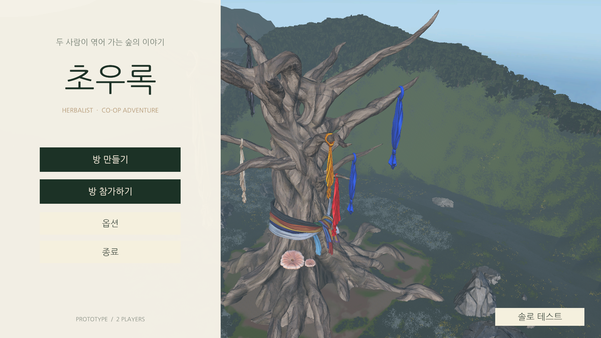
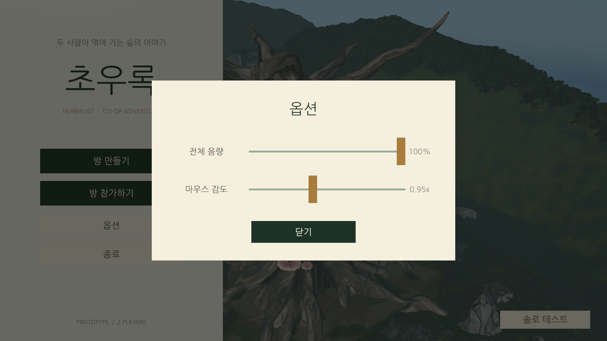
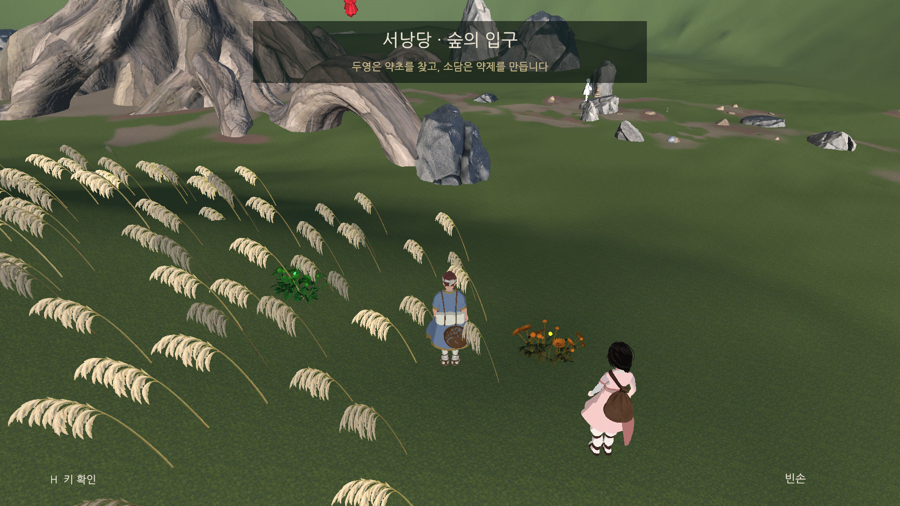
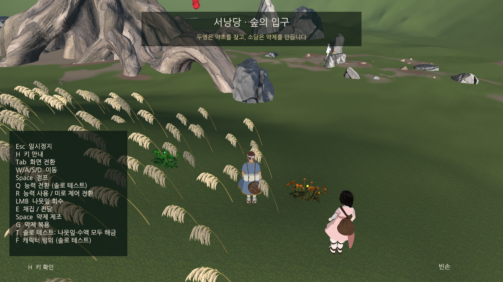
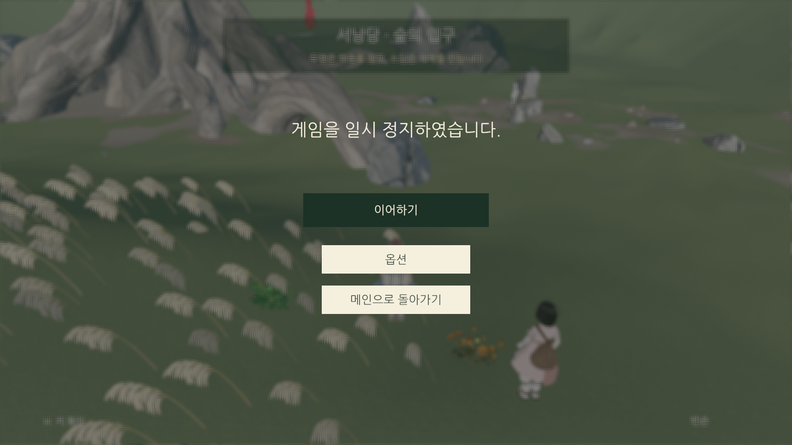
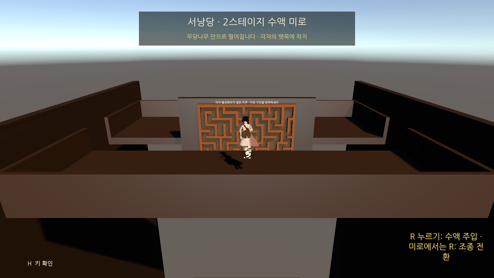
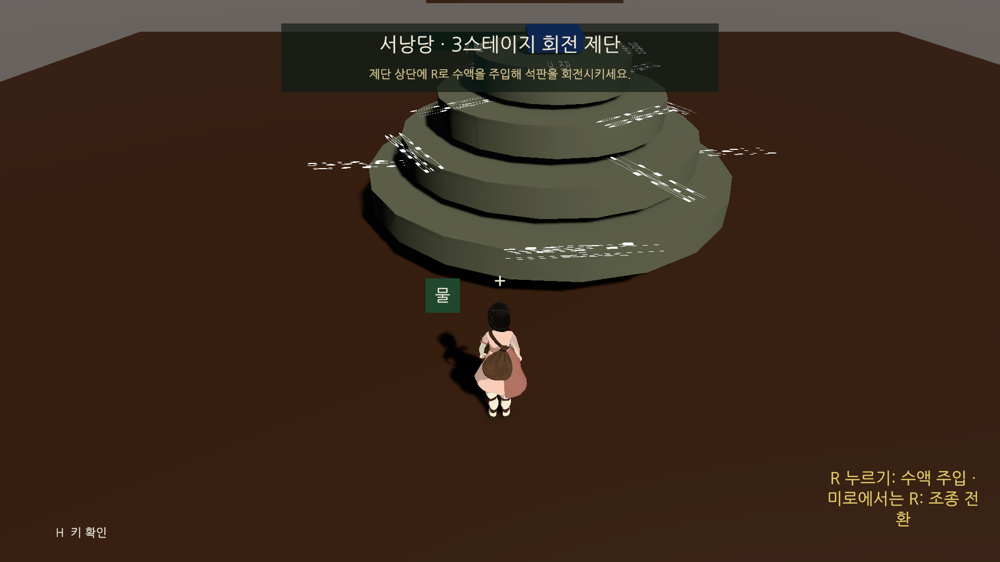
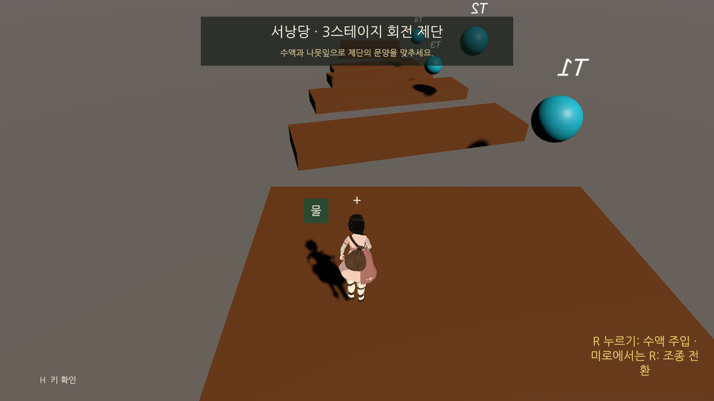

# 현재 UI 해상도와 화면 캡처 (1920×1080)

확인일: 2026-10-15  
Unity: 6000.6.0f1 / Windows Game View `Full HD` 고정 해상도

## 해상도 기준

| 항목 | 현재 값 | 의미 |
| --- | --- | --- |
| 실제 캡처 크기 | **1920×1080 px** | 아래 PNG 파일의 원본 크기. 게임 뷰 `Full HD`에서 캡처했다. |
| uGUI 기준 해상도 | **1280×720** | 화면용 Canvas의 `Canvas Scaler > Reference Resolution`. |
| UI Scale Mode | `Scale With Screen Size` | 화면 크기에 따라 UI를 확대·축소한다. |
| Screen Match Mode | `Match Width Or Height`, 0.5 | 가로와 세로 기준을 절반씩 반영한다. |
| 이번 캡처의 배율 | **1.5배** | 두 해상도가 모두 16:9이므로 기준 좌표 1px이 출력에서 1.5px이 된다. |

아래의 **설계 크기**는 프리팹 `RectTransform`의 1280×720 기준 값이다. **화면 크기**는 1920×1080에서 예상되는 크기다. 실제 표시 범위는 부모 앵커, 화면 모드, 활성 상태에 따라 달라질 수 있다. `Stage_03`의 일부 표시는 `World Space` Canvas이므로 이 표의 화면 배율을 그대로 적용하지 않는다.

| UI | 프리팹 설계 크기 | 1920×1080에서의 크기 | 위치/용도 |
| --- | ---: | ---: | --- |
| 메인 메뉴 `MenuPaper` | 470×720 | 705×1080 | 화면 왼쪽 메뉴 영역 |
| 메인 메뉴 버튼 `Create`/`Join` | 300×52 | 450×78 | 방 만들기/참가하기 |
| 캐릭터 선택 카드 `DuyeongCard`/`SodamCard` | 380×400 | 570×600 | 방 진입 뒤 역할 선택 |
| 옵션 `Card` | 640×380 | 960×570 | 화면 중앙 설정 창 |
| 공통 `StageHeader` | 560×88 | 840×132 | 스테이지 제목·목표 |
| 일시정지 `Resume` | 300×55 | 450×82.5 | 이어하기 버튼 |
| 플레이어 `HelpPanel` | 300×320 | 450×480 | H 키 조작 안내 |
| 로딩 `ProgressCard` | 380×100 | 570×150 | 씬 전환 중 표시 |

크기 출처: [`PF_MainMenuScreen.prefab`](../../Prefabs/UI/PF_MainMenuScreen.prefab), [`PF_OptionsPanel.prefab`](../../Prefabs/UI/PF_OptionsPanel.prefab), [`PF_GameOverlayHud.prefab`](../../Prefabs/UI/PF_GameOverlayHud.prefab), [`PF_PlayerHud.prefab`](../../Prefabs/UI/PF_PlayerHud.prefab), [`PF_LoadingPanel.prefab`](../../Prefabs/UI/PF_LoadingPanel.prefab).

## 실제 게임 화면

모든 이미지는 Unity **Game View에서 1920×1080 원본 PNG**로 캡처했다. 플레이어 한 명을 조작하는 솔로 직접 실행 화면이므로, 두 사람의 분할 화면이나 네트워크 방 상태를 보여 주는 이미지는 아니다.

### 메인 메뉴

왼쪽은 방 만들기·참가하기·옵션·종료, 오른쪽은 실시간 스테이지 배경이다. 솔로 테스트 버튼은 오른쪽 아래에 있다.

### 메인 메뉴 옵션

전체 음량과 마우스 감도 슬라이더가 중앙의 960×570 px 카드에 표시된다.

### 1스테이지 기본 HUD

상단의 스테이지 제목·목표와 하단의 조작 안내·소지품 영역을 확인했다. 능력 선택과 소지 상태에 따라 하단 문구가 바뀐다.

### 1스테이지 조작 도움말

H 키로 여는 플레이어 도움말이다. 아래 이미지는 해당 HUD의 도움말 상태를 활성화해 캡처했다.

### 게임 일시정지

이어하기·옵션·메인으로 돌아가기 메뉴가 화면 중앙에 표시된다.

### 2스테이지 수액 미로

상단 단계 안내, 화면 중심 조준점, 하단 플레이어 안내가 표시된다.

### 3스테이지 회전 제단

상단 목표와 하단 플레이어 안내를 확인했다. 제단 위의 흰색 방향 표시는 화면 HUD가 아닌 월드 공간 표시다.

### 별도 빌드 씬: 3스테이지 가지 타기

현재 Build Settings에도 포함된 `Stage_03_BranchRide`의 HUD를 별도로 캡처했다.

## 확인 범위와 화면상 관찰

- 메뉴 홈·옵션, 1스테이지 기본 HUD·도움말·일시정지, 2스테이지, 3스테이지 두 씬을 실제 게임 뷰에서 확인했다.
- 방 코드 입력·캐릭터 선택·로딩·약제 제조 미니게임은 조건부로 열리는 UI이므로 이번 이미지에는 포함하지 않았다. 위 표에는 해당 프리팹의 설계 크기만 기록했다.
- 스테이지 2·3 화면의 오른쪽 아래 능력 안내 문구가 좁은 폭에서 여러 줄로 줄바꿈된다. 1920×1080에서도 보이는 현상이다.
- 3스테이지 월드 공간 방향 표시는 화면 HUD와 다른 렌더링 경로를 사용한다. 회전 제단 캡처에서는 흰색 표시가 겹쳐 보인다.
